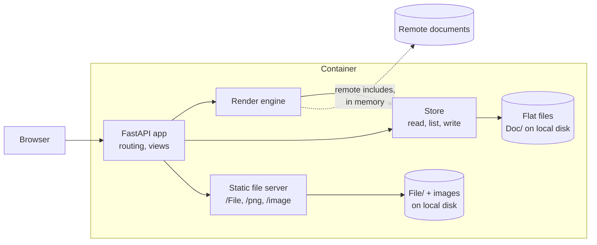
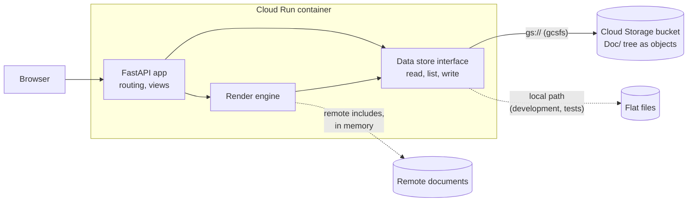

# App architecture

- The Python server app ([app/](../app/)): how it reaches its data, now and after the move to Google Cloud
- Hosting, identity, networking: [infra-architecture.md](infra-architecture.md)
- Renderer design and parity: [migration/initial-python-port.md](migration/initial-python-port.md), [decisions.md](decisions.md)

## Current: flat files on local disk

- The app reads documents through `Store` ([store.py](../app/cmacc/store.py)), configured by `CMACC_STORE`
- Deployed today with a local path: the store is plain files on the container's disk
  - in the local cluster an init container copies `Doc/` and `File/` from the templates image into a Pod volume
- Static assets (icons, images) are baked into the app image; supporting files (`File/`) are served from disk
- Remote includes (`http…` targets) are fetched in memory with a timeout
- Saves overwrite files on that disk: [migration/legacy-document-storage.md](migration/legacy-document-storage.md)

## Target: abstracted data store on Cloud Storage objects

- The app talks only to the data store interface; it does not know where documents live
- Backed by Google Cloud Storage: one object per document, object name = `Doc/` path (the tree is kept in the names)
- Selected by configuration, not code: `CMACC_STORE=gs://<bucket>/Doc` through fsspec's Cloud Storage backend (gcsfs)
- Local development keeps the same interface with a local path, so tests and parity runs do not need Google Cloud
- No local disk state: Cloud Run instances are disposable
- One image, two deployments ([user-management.md](user-management.md)):
  - read service: saves switched off by a setting (no Save button, save requests rejected)
  - edit service: saves on; records the signed-in editor from the verified IAP header (`X-Goog-IAP-JWT-Assertion`)
- Reads cached in memory per instance: a render reads many objects, and each read is a Cloud Storage request

- Still to decide, app side:
  - `File/` and images: objects in the same bucket, or baked into the image
  - cache invalidation: how long a cached object may be stale after an edit (edits on one instance, reads on another)
  - listing: object stores have no real folders; folder listings become prefix queries
  - what the app keeps in Cloud SQL beyond save records
