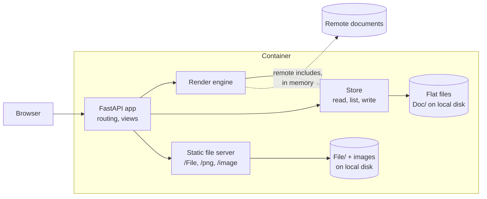
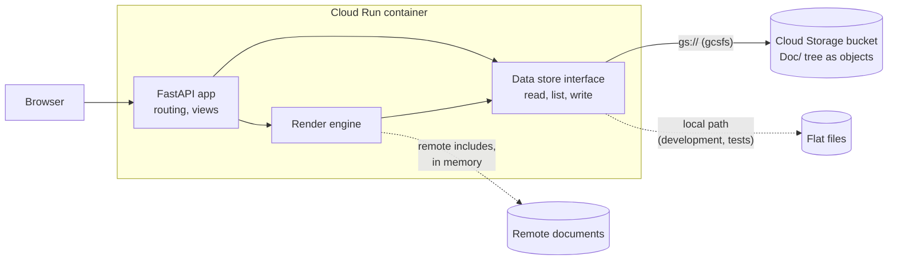

# App architecture

- The Python server app ([app/](../app/)): how it reaches its data, now and after the move to Google Cloud
- Hosting, identity, networking: [infra-architecture.md](infra-architecture.md)
- Renderer design and parity: [migration/initial-python-port.md](migration/initial-python-port.md), [decisions.md](decisions.md)

## Current: flat files on local disk

- The app reads documents through `Store` ([store.py](../app/cmacc/store.py)), configured by `CMACC_STORE`
- Deployed today with a local path: the store is plain files on the container's disk
  - in the local cluster an init container copies `Doc/` and `File/` from the templates image into a Pod volume
- Static assets (icons, images) are baked into the app image; supporting files (`File/`) are served from disk
- Remote includes (`http…` targets) are fetched in memory with a timeout
- Saves overwrite files on that disk: [migration/legacy-document-storage.md](migration/legacy-document-storage.md)

## Target: abstracted data store on Cloud Storage objects

- The app talks only to the data store interface; it does not know where documents live
- Backed by Google Cloud Storage: one object per document, object name = `Doc/` path (the tree is kept in the names)
- Selected by configuration, not code: `CMACC_STORE=gs://<bucket>/Doc` through fsspec's Cloud Storage backend (gcsfs)
- Local development keeps the same interface with a local path, so tests and parity runs do not need Google Cloud
- No local disk state: Cloud Run instances are disposable
- One image, two deployments ([user-management.md](user-management.md)): read service with saves off, edit service with saves on
- Supporting files (`File/`) are objects in the same bucket under `File/`; icons and images stay baked into the app image

## Behavior on Google Cloud

- Accepted specification choices ([todo.md](todo.md), C1–C17, C25); the app changes they need are listed there

### Saves

- **Saves off** (read service): `CMACC_SAVES=false` hides the Save button; any request with `submit` gets 403 and a short message; nothing is written
- **Who saved**: the edit service verifies the signed IAP header (`X-Goog-IAP-JWT-Assertion`) and takes the editor's email from it
  - header missing or invalid: saves refused (no identity, no save); views still served, since IAP already admitted the request
  - local development: a dev setting supplies a fixed test identity
- **Cross-site protection**: a save is accepted only when `Origin` (or `Sec-Fetch-Site: same-origin`) shows the form came from the edit service itself; no secret needed
- **Concurrent saves**: the edit form carries the object's generation; the write uses Cloud Storage's `if-generation-match`; if the template changed since the editor opened it, the save is refused with "changed since you opened it, reload", nothing is overwritten
- **Save record**: one row in Cloud SQL per save: id, template path, editor email, time (UTC), new generation, previous generation, size; Cloud SQL holds nothing else
- **Scope**: existing templates only; no creating or deleting through the app (as in legacy); new templates are uploaded by a user admin
- **Form note**: "Saves are kept. Earlier versions can be restored by a user admin." replaces the legacy "your changes are temporary"

### Reading

- **Cache**: per instance, in memory, bounded (about 64 MB, least recently used); entries expire after 60 seconds; a save refreshes the saving instance's entry at once; folder listings (prefix queries on the bucket) cached the same way
  - so a save shows at once on the edit service, and within a minute everywhere
- **Storage errors** (timeout, 429, 5xx): `gcsfs` retries; a read that still fails is reported like a missing include; never a half page, never a stack trace
- **Remote includes**: public `http(s)` URLs fetched in memory with the timeout; private, loopback and link-local addresses refused (including the metadata server), also when reached by a redirect; template editors can add includes, so the server must never reach internal addresses
- **GitHub and Compare links**: hidden on the cloud deployment (`CMACC_REPO_URL` empty); git is a backup there, not the live source

### Operations

- **Logs**: one JSON line per request to stdout for Cloud Logging: path, view, status, render time; saves add editor email and generations
- **Health**: a small page for Cloud Run's startup probe that does not read the bucket
- **Sign-out**: a "Sign out" link in the header to IAP's sign-out URL (`?gcp-iap-mode=CLEAR_LOGIN_COOKIE`)
