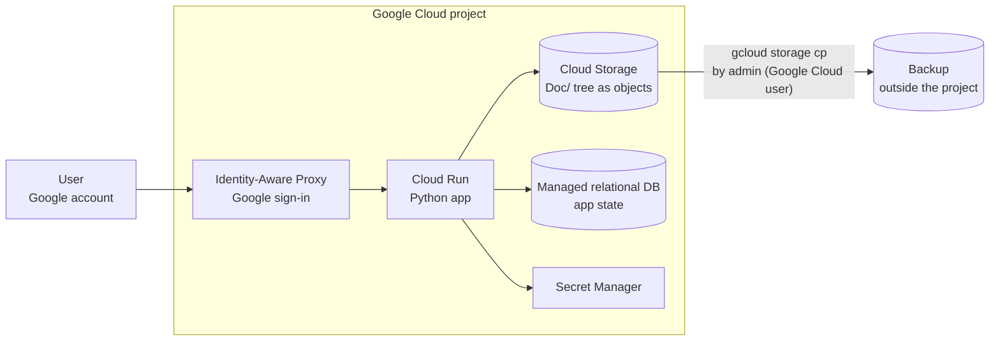

# Infrastructure architecture (Google Cloud)

- **Stub**: what is decided so far for hosting on Google Cloud; open items listed at the end
- The app side (data store interface): [app-architecture.md](app-architecture.md)
- Local development on OrbStack stays as described in [infra/README.md](../infra/README.md)

## Decided

- One Google Cloud project holds everything: app, documents, database, secrets
- Users sign in with Google accounts through Identity-Aware Proxy (IAP); nothing reaches the app without it
- The app runs on Cloud Run, sized to stay within the free tier
- The `Doc/` tree is stored as Cloud Storage objects
- App state lives in a managed relational database, the cheapest option that fits
- Secrets live in Secret Manager in the same project
- The human admin is a Google Cloud user with `gcloud` access, and retrieves the `Doc/` contents with it for backups



## Admin backups

- Data leaves the project: the admin copies the document tree out of the bucket to another system with `gcloud`, e.g.

```bash
gcloud storage cp --recursive gs://<bucket>/Doc ./backup/
```

## Open

- Project name, region, billing account
- IAP setup on Cloud Run, and who is allowed in (users, groups, domain)
- Database: which managed service and size (Cloud SQL has no free tier; the smallest instance is the cost floor), and what app state it holds
- Bucket: versioning, retention, access for the app's service account (read-only if editing is dropped)
- How the corpus gets into the bucket from the git repository, and how updates flow
- Image build and registry (Artifact Registry), and how deploys are triggered
- Free-tier limits: requests, CPU, memory, egress; what happens when they are exceeded
- Logging, monitoring, budget alerts
