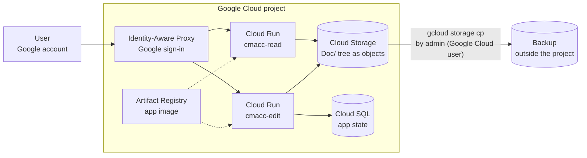

# Infrastructure architecture (Google Cloud)

- **Stub**: what is decided so far for hosting on Google Cloud; open items listed at the end
- The app side (data store interface): [app-architecture.md](app-architecture.md)
- Groups, roles and powers of admins, template editors and users: [user-management.md](user-management.md)
- Local development on OrbStack stays as described in [infra/README.md](../infra/README.md)

## Decided

- One Google Cloud project holds everything: app, documents, database, secrets
- Users sign in with Google accounts through Identity-Aware Proxy (IAP), enabled directly on Cloud Run (no load balancer); nothing reaches the app without it
- The app runs on Cloud Run, sized to stay within the free tier
  - two services from one image: `cmacc-read` (everyone) and `cmacc-edit` (template editors); see [user-management.md](user-management.md)
- The `Doc/` tree is stored as Cloud Storage objects
- App state lives in Cloud SQL, the smallest instance
- Secrets, if any, live in Secret Manager in the same project
- Administration in three layers, each a superset of the next ([user-management.md](user-management.md)):
  - project owner (CEO): Owner role and billing
  - cloud admin (architect / tech lead): builds, deploys and runs the project, IAM included; everything except billing
  - user admin: manages app users; a Google Cloud user with `gcloud` access who copies the `Doc/` contents out of the project for backups



## Lean defaults

- Region: `us-central1`, `us-east1` or `us-west1`: the Cloud Storage free tier applies only there; everything in the same region
- Cloud Run
  - request-based billing (CPU only during requests), minimum instances 0: scales to zero, cold start on first request
  - maximum instances small (e.g. 2): caps cost and the damage a runaway request can do
  - own service account per service, never the default Compute Engine account
- Cloud Storage: Standard class, uniform bucket-level access, public access prevention, object versioning with a lifecycle rule that deletes old versions
- Artifact Registry: cleanup policy keeping the last few images, to stay under the free storage
- Cloud SQL
  - smallest shared-core instance (`db-f1-micro`), no high availability, smallest disk, automated backups on
  - connect with the Cloud SQL Python connector and IAM database authentication: no password, no public authorized networks
  - shared-core instances have no SLA; acceptable for app state that can be rebuilt
- Secret Manager: only if a secret is unavoidable; IAM database authentication removes the database password
- Billing budget with email alerts at small thresholds (budgets and alerts cost nothing)
- Infrastructure as code (Terraform or a `gcloud` script) kept in the repository, so the project can be rebuilt

## Expected cost

| Service | Free per month (per billing account) | This app |
|---|---|---|
| Cloud Run | 2M requests; 180,000 vCPU-seconds, 360,000 GiB-seconds (request-based billing) | well inside at low traffic |
| Cloud Storage | 5 GB-months Standard in the three US regions; 5,000 Class A and 50,000 Class B operations | corpus is 41 MB (6,773 objects); every render reads several objects, so reads can pass 50,000 a month: cents, and an in-app cache cuts them |
| Artifact Registry | 0.5 GB storage | one slim Python image; cleanup policy needed |
| Secret Manager | 6 active secret versions, 10,000 accesses | likely unused |
| Cloud Logging | 50 GiB ingestion | inside |
| IAP | no charge for Google-account sign-in | — |
| Cloud Identity Free | no charge | — |
| **Cloud SQL** | **no free tier** | **about $8–10 a month (`db-f1-micro`), plus disk and backups: the only fixed cost** |

- Figures checked on 2026-11-14 against Google's free tier and pricing pages; recheck before relying on them
- Free-tier usage over the limit is billed at normal rates; it does not stop the service

## Admin backups

- Data leaves the project: the admin copies the document tree out of the bucket to another system with `gcloud`, e.g.

```bash
gcloud storage cp --recursive gs://<bucket>/Doc ./backup/
```

## Caveats to recheck when building

- IAP directly on Cloud Run: Google's release notes listed it as Preview (April 2025); confirm it is generally available before relying on it, or fall back to an external HTTPS load balancer with IAP (which has a monthly cost)
- IAP's Google-managed OAuth client only admits users of the project's organization; outside Google accounts need a custom OAuth client ([user-management.md](user-management.md))
- Cloud SQL is the only part with no free tier; if the app state stays small, revisit whether it needs a relational database at all

## Open

- Project name, region, billing account, Cloud Identity domain
- What app state the database holds beyond save records
- How the corpus gets into the bucket from the git repository, and how updates flow
- Image build (Cloud Build or local) and how deploys are triggered
- Old object versions: how many and for how long
- Logging, monitoring, budget thresholds
