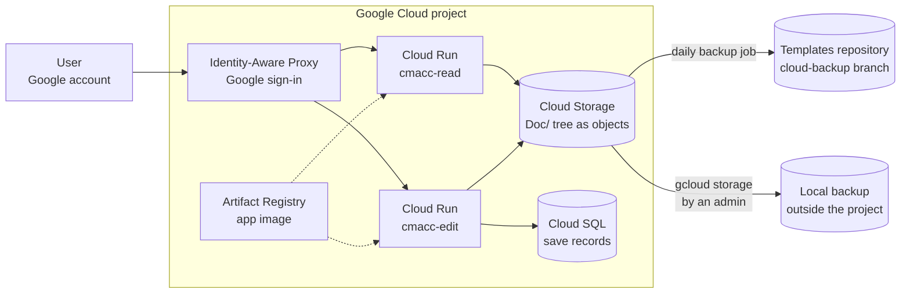

# Infrastructure architecture (Google Cloud)

- **Stub**: what is decided so far for hosting on Google Cloud; open items listed at the end
- The app side (data store interface): [app-architecture.md](app-architecture.md)
- Groups, roles and powers of admins, template editors and users: [user-management.md](user-management.md)
- Secrets: [secrets.md](secrets.md); tooling still to build: [todo.md](todo.md)
- Local development on OrbStack stays as described in [infra/README.md](../infra/README.md)

## Decided

- One Google Cloud project holds everything: app, documents, database, secrets
- Users sign in with Google accounts through Identity-Aware Proxy (IAP), enabled directly on Cloud Run (no load balancer); nothing reaches the app without it
- The app runs on Cloud Run, sized to stay within the free tier
  - two services from one image: `cmacc-read` (everyone) and `cmacc-edit` (template editors); see [user-management.md](user-management.md)
- The `Doc/` tree is stored as Cloud Storage objects, and the bucket is its source of truth
  - `Doc/` lives in its own templates repository (`<templates-repo>`), not in this app repository
  - loaded once into the bucket from a checkout of the templates repository; after that the bucket is live
  - app deploys never change the objects; editors change them through the app
  - protected by object versioning, a daily backup job that commits to the templates repository ([todo.md](todo.md) T7), and hand-run backups
  - supporting files (`File/`) live in the same bucket under `File/`; icons and images are baked into the app image
- Cloud SQL, the smallest instance, holds save records only (who saved which template, when, which object versions)
- Secrets, if any, live in Secret Manager in the same project
- Administration in three layers, each a superset of the next ([user-management.md](user-management.md)):
  - project owner (CEO): Owner role and billing
  - cloud admin (architect / tech lead): builds, deploys and runs the project, IAM included; everything except billing
  - user admin: manages app users; a Google Cloud user with `gcloud` access who copies the `Doc/` contents out of the project for backups



## Lean defaults

- Region: `us-central1` for everything (one of the three Cloud Storage free-tier regions; Cloud Run, Cloud SQL and Cloud Scheduler all available there)
- Cloud Run
  - request-based billing (CPU only during requests), minimum instances 0: scales to zero, cold start on first request
  - per service: 1 vCPU, 512 MiB (renders peak under 200 MB, [decisions.md](decisions.md) D4), concurrency 10, max 2 instances, request timeout 60 s
  - max 2 instances caps cost and the damage a runaway request can do
  - startup probe on a small page that does not read the bucket; no liveness probe
  - own service account per service, never the default Compute Engine account
- Cloud Storage: Standard class, uniform bucket-level access, public access prevention, object versioning
  - lifecycle rule: keep the newest 20 earlier versions of each object; delete earlier versions older than 365 days
- Artifact Registry: cleanup policy keeping the last few images, to stay under the free storage
- Cloud SQL
  - smallest shared-core instance (`db-f1-micro`), no high availability, smallest disk, automated backups on
  - connect with the Cloud SQL Python connector and IAM database authentication: no password, no public authorized networks
  - shared-core instances have no SLA; acceptable for app state that can be rebuilt
- Secret Manager: only if a secret is unavoidable; IAM database authentication removes the database password
- Billing budget with email alerts, set by hand by the project owner (not in Terraform, so Terraform needs no billing role); amounts are the owner's
- Alerts to the cloud admins: backup job failed or no success in 2 days; either service returning 5xx above a few per hour
- Logs: one JSON line per request from the app (path, view, status, render time; saves add editor and object versions), kept by Cloud Logging's default retention
- Builds and deploys: built locally with the pinned toolchain and deployed by hand by the cloud admin (`task cloud:deploy`); CI later, with Workload Identity Federation
- Infrastructure as code in Terraform, kept in the repository, so the project can be rebuilt and drift is visible ([todo.md](todo.md) T1)

## Expected cost

| Service | Free per month (per billing account) | This app |
|---|---|---|
| Cloud Run | 2M requests; 180,000 vCPU-seconds, 360,000 GiB-seconds (request-based billing) | well inside at low traffic |
| Cloud Storage | 5 GB-months Standard in the three US regions; 5,000 Class A and 50,000 Class B operations | corpus is 41 MB (6,773 objects); every render reads several objects, so reads can pass 50,000 a month: cents, and an in-app cache cuts them |
| Artifact Registry | 0.5 GB storage | one slim Python image; cleanup policy needed |
| Secret Manager | 6 active secret versions, 10,000 accesses | likely unused |
| Cloud Logging | 50 GiB ingestion | inside |
| IAP | no charge for Google-account sign-in | — |
| Cloud Identity Free | no charge | — |
| **Cloud SQL** | **no free tier** | **about $8–10 a month (`db-f1-micro`), plus disk and backups: the only fixed cost** |

- Figures checked on 2026-11-14 against Google's free tier and pricing pages; recheck before relying on them
- Free-tier usage over the limit is billed at normal rates; it does not stop the service

## Backups

- Daily at 03:00 UTC, a Cloud Run job commits the bucket's `Doc/` to the `cloud-backup` branch of the templates repository ([todo.md](todo.md) T7)
- By hand, an admin copies the tree out of the project ([use-cases/user-admin.md](use-cases/user-admin.md)), e.g.

```bash
gcloud storage cp --recursive gs://<bucket>/Doc ./backup/
```

## Caveats to recheck when building

- IAP directly on Cloud Run: Google's release notes listed it as Preview (April 2025); confirm it is generally available before relying on it, or fall back to an external HTTPS load balancer with IAP (which has a monthly cost)
- IAP's Google-managed OAuth client only admits users of the project's organization; outside Google accounts need a custom OAuth client ([user-management.md](user-management.md))
- Cloud SQL is the only part with no free tier; if the app state stays small, revisit whether it needs a relational database at all

## Open

- Project name, billing account, Cloud Identity domain
- Budget amounts and alert thresholds (project owner)
