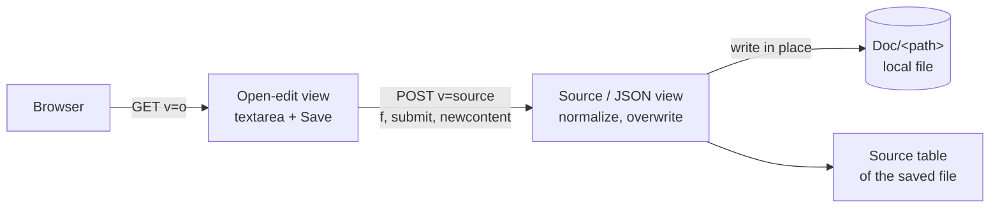

# Legacy document storage

- How documents (the `Doc/` tree) are stored and saved today, in the legacy PHP/Perl app and in the Python port
- **Legacy pattern, being replaced**: documents move from flat files to Google Cloud Storage objects
  - target: [app-architecture.md](../app-architecture.md) (the app's data store), [infra-architecture.md](../infra-architecture.md) (hosting)
- Recorded as the baseline for change management: what users and operators rely on now

## Storage today

- Documents are flat files under `Doc/` in the git repository
- The app reads them from the local file system of whatever server or container runs it
- The repository is the source of truth; every deployment starts from a copy of it

## How a save works

- Editing UI: the Open-edit view (`v=o`)
  - textarea with suggested lines for unresolved fields, then the file as it is
  - Save button posts to `i.php` with `f=<path>`, `v=source`, `submit`, `newcontent`
- The Source (`v=s`) and JSON (`v=j`) views save when `submit` is present, then show the file
- The posted text is normalized: CRLF → LF, leading and trailing whitespace trimmed
- The existing file is overwritten in place
  - only existing files: a new path gives "ERROR: File … does not exists."
  - legacy also refuses a file the web server cannot write ("is not write able")

| Implementation | Code |
|---|---|
| Legacy PHP | [cmacc_helpers.php](../../vendor/cmacc-app/cmacc_helpers.php): Source and JSON cases, `fopen(…, "w")` + `fwrite` (the same block twice) |
| Python | `file_view` → `save` in [main.py](../../app/cmacc/main.py); `Store.write` in [store.py](../../app/cmacc/store.py) (`fs.isfile`, then `fs.pipe_file`) |
| Python test | `test_save` in [test_views.py](../../app/tests/test_views.py) |

## What a save does not do

- No login, no permission check: anyone who can reach the site can overwrite any document
- No history, no previous version kept, no record of who changed what
- No commit to git; saves never reach the repository
- No locking: two concurrent saves of the same file, last one wins

## Where saves land and how long they last

| Deployment | Written to | Lost when |
|---|---|---|
| Public site (commonaccord.org) | server checkout, `/var/www/commonaccord/Doc/` | next push to `master`: the deploy workflow runs `git reset --hard origin/master` ([deploy.yml](../../.github/workflows/deploy.yml)) |
| Local legacy container | the image's copy of `Doc/` in the container | Pod replaced or restarted |
| Local Python app | Pod-local volume, filled from the templates image at start ([app.yaml](../../infra/k8s/app.yaml)) | Pod replaced or restarted |

- So in practice saves are temporary scratch edits; the edit form says so to users:
  "Your changes are temporary and will be discarded when the site next updates from the Github repo."
- Real changes to documents go through git (commits and pull requests to the repository)

## Why this changes

- Cloud Run has no durable local disk; the document tree becomes Cloud Storage objects
- The Python store is already behind fsspec, so the same `Store.write` would overwrite a Cloud Storage object
  - that save would be permanent, not temporary: the user-facing promise above would become false
- Users sign in through Google IAP, so a save could be attributed to a person
- Open decision for the new design: drop editing, restrict it to some users, or keep it with object versioning so changes can be undone
