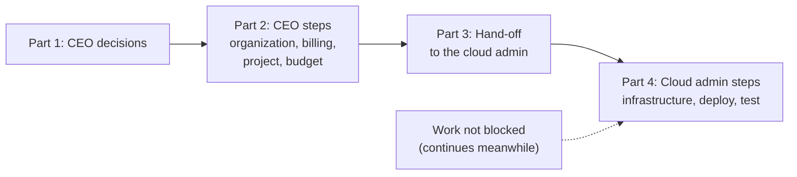
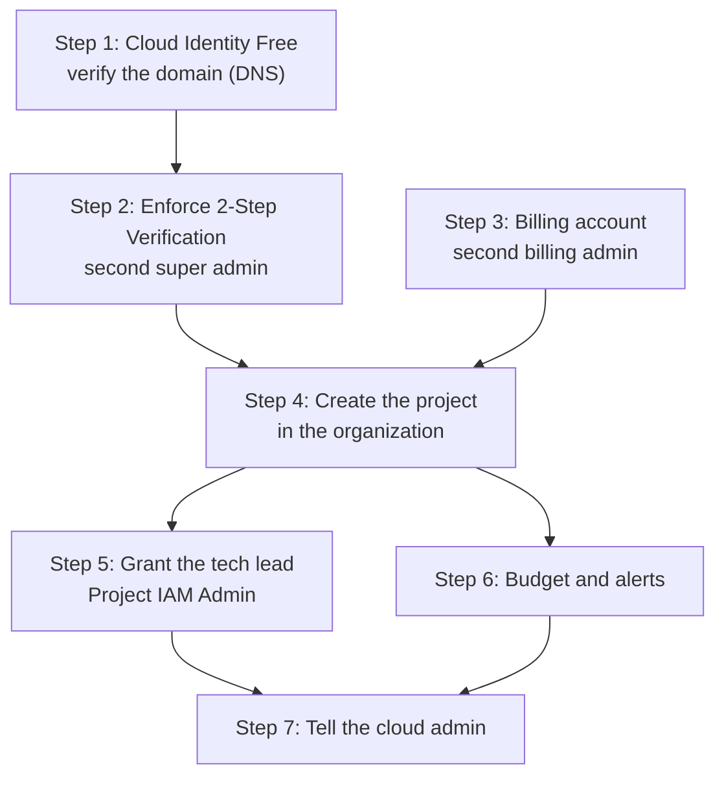

# Decisions and steps for the project owner (CEO)

- **Status**: the move to Google Cloud is blocked until the Google Cloud project and its billing exist; only the project owner (CEO) can create them
- This page lists, in order: the decisions needed from the CEO, the CEO's hands-on steps, and what the cloud admin (tech lead) does once they are done
- Background: [plan.md](plan.md) (phases 0–2), [user-management.md](../user-management.md) (roles), [infra-architecture.md](../infra-architecture.md) (expected cost)

## 1. Decisions needed from the CEO

| # | Decision | Recommendation | Why it matters |
|---|---|---|---|
| D1 | **Company domain** for the Google organization | the company's main web domain | Google sign-in, the groups, and the project all hang off it; someone must be able to add a DNS record to it to prove ownership |
| D2 | **Who may sign in**: only accounts in the company domain, or any Google account (e.g. gmail.com) | decide from who the users are; any Google account if outside lawyers or clients will use it | any Google account needs one extra sign-in setup step by the cloud admin; no cost difference |
| D3 | **Billing account**: an existing company one, or a new one | an existing company account, if there is one | it is where the monthly charge lands; it needs a payment method |
| D4 | **Monthly budget** and alert levels | budget **$25 a month**, email alerts at 50%, 90%, 100% | expected cost is about **$10–15 a month**: Cloud SQL (about $8–10) plus small disk and backup charges; everything else stays in Google's free tiers. Alerts only warn; nothing stops automatically |
| D5 | **Second billing administrator** | one trusted person besides the CEO (not necessarily technical) | if the CEO's account is lost, nobody else can fix billing, and the service stops when payment fails |
| D6 | **Project ID** (permanent, cannot be changed or reused) | e.g. `<company>-cmacc` | appears in URLs and commands; must be unique across Google Cloud |
| D7 | **Templates repository**: a new one owned by the company, or upstream CommonAccord's | a new company repository, created from this repository's history | decides who controls the templates' backup history; affects the relationship with CommonAccord (the corpus is theirs today) |
| D8 | **Named people** for each admin role | cloud admin: tech lead; user admin(s): to be named | user admins add users and run backups; they need Google accounts in, or allowed by, the organization |

- Not blocking now, decide later: the future of the legacy public site (it still deploys from this repository)

## 2. Steps the CEO does

- About an hour of console work, plus waiting for DNS verification (minutes to hours)
- All steps are in a web browser; no command line

1. **Create the organization** (needs D1)
   - sign up for **Cloud Identity Free** at `workspace.google.com/gcpidentity/signup` with the company domain
   - add the DNS record Google shows to the domain, to verify it (whoever manages the domain's DNS can do this)
   - the CEO becomes the first super admin
2. **Secure the organization**
   - Admin console (`admin.google.com`) → Security → 2-Step Verification: turn on enforcement
   - make the tech lead a second super admin (so the organization is never locked out)
3. **Set up billing** (needs D3, D5)
   - Google Cloud console (`console.cloud.google.com`) → Billing: choose the existing billing account or create one with a payment method
   - add the second billing administrator (D5)
4. **Create the project** (needs D6)
   - console → New project: project ID from D6, organization from step 1, billing account from step 3
5. **Hand the project to the cloud admin**
   - console → IAM: grant the tech lead **Project IAM Admin** on the project
   - with it the cloud admin grants the rest of the cloud admin roles through the infrastructure code, as designed ([user-management.md](../user-management.md))
6. **Set the budget** (needs D4)
   - console → Billing → Budgets & alerts: budget for this project, amount and alert levels from D4, emails to the CEO and the tech lead
7. **Tell the cloud admin**: project ID, organization domain, and the answers to D2, D7, D8

## 3. After the hand-off: cloud admin steps

- In [plan.md](plan.md) order; the CEO is needed again only for billing changes and for the go-live sign-off

| Step | What happens | Plan phase |
|---|---|---|
| Groups and accounts | create the five groups and their owners; nest the admin groups; add the CEO to `cmacc-owners` and move the Owner role to that group; create one test account per role | 1 |
| Sign-in setup | if D2 is "any Google account": IAP consent screen and sign-in client | 1–2 |
| Infrastructure | create the Terraform state bucket; review `terraform plan`; `terraform apply`: services, bucket, database, registry, roles, backup job, alerts | 2 |
| Templates | split the templates repository (D7); load the templates into the bucket | 4 |
| First deploy | build and deploy the app; smoke test | 5 |
| Backup job | git credential into Secret Manager; first backup run; failure alert tested | 6 |
| Acceptance test | each role tested with its test account | 7 |
| Go live | real users added; CEO informed | 8 |

## Work not blocked (continues meanwhile)

- App changes for the cloud ([todo.md](../todo.md) "App changes"), tested locally against an emulated object store (T12)
- Writing the infrastructure code (T1); it is applied only after the hand-off
- Preparing the templates repository split (T11) and the checkout script (T8)
- Backup, restore and deploy scripts (T3, T5, T6)
