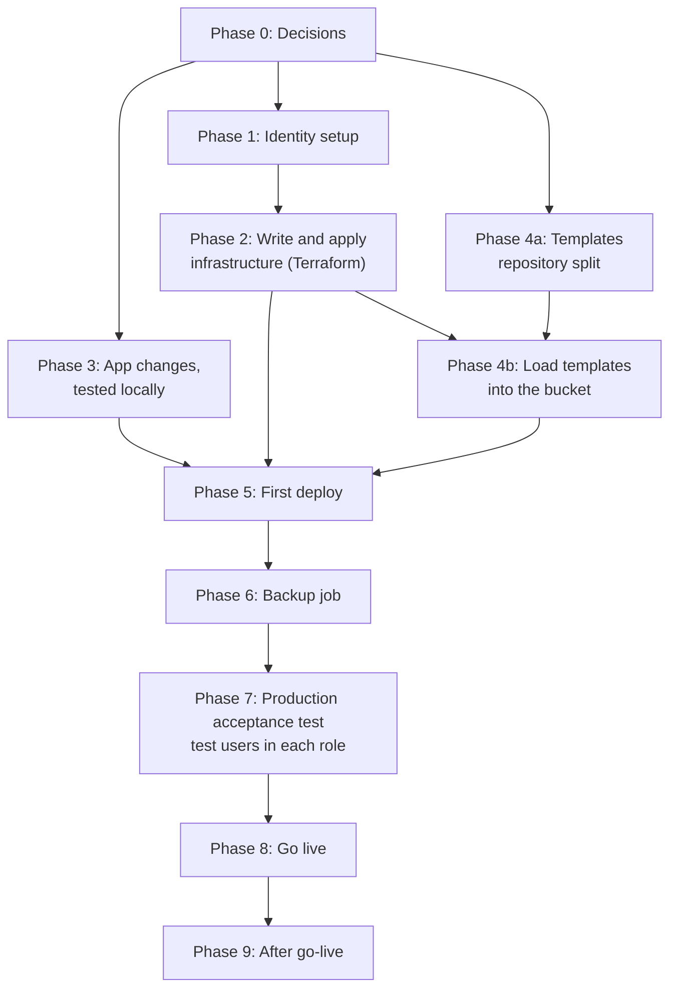

# Migration plan: Google Cloud

- **Proposed**: the order of work from today's local setup to the app running for real users on Google Cloud
- Each phase names its tooling ([todo.md](../todo.md)), who does it, and how it is known to be done
- Design: [infra-architecture.md](../infra-architecture.md), [user-management.md](../user-management.md), [app-architecture.md](../app-architecture.md); walkthroughs: [use-cases/](../use-cases/README.md)

## 0. Decisions

- **Who**: project owner and cloud admin
- The project owner's decisions and hands-on steps, which block phases 1 and 2: [owner-decisions.md](owner-decisions.md)
- Decide before building:
  - domain for the Cloud Identity Free organization; whether users are outside it (custom OAuth client or not)
  - project name, billing account
  - templates repository: new, or upstream CommonAccord's ([todo.md](../todo.md) T11)
  - budget amounts
- Already decided: region `us-central1`; Cloud SQL holds save records only; the implementation choices C1–C25 ([todo.md](../todo.md))
- **Done when**: answers recorded in the design documents, open items closed

## 1. Identity setup

- **Who**: project owner (super admin, billing), cloud admin
- **Tooling**: T10 checklist (manual, Google web consoles)
- Organization, two super admins, 2-Step Verification enforced
- Groups with their owners: `cmacc-owners`, `cmacc-cloud-admins`, `cmacc-user-admins`, `template-editors`, `cmacc-users`; nesting of the admin groups
- Project created in the organization and linked to billing; budget and alerts set by the owner
- Test accounts created, one per role (used in phase 7)
- **Done when**: each group exists with the right owner; the owner and cloud admin can sign in to the project

## 2. Write and apply the infrastructure

- **Who**: cloud admin
- **Tooling**: T1 (Terraform, in this repository)
- Steps
  1. write the Terraform definition: APIs, service accounts, bucket, Cloud SQL, Artifact Registry, Cloud Run services, IAP, IAM bindings, backup job, alerts
  2. review it as a pull request, against the role table in [user-management.md](../user-management.md)
  3. `terraform plan`: read what will be created
  4. `terraform apply`
  5. manual parts: IAP OAuth consent screen and client, Cloud SQL admin password into Secret Manager ([secrets.md](../secrets.md) S1, S2)
- Cloud Run services can be created with a placeholder image here; the real app arrives in phase 5
- **Done when**: `terraform plan` reports no changes; every resource and binding in the design exists

## 3. App changes, tested locally

- **Who**: developers
- **Tooling**: T8 (templates checkout), T12 (local object store)
- App changes from [todo.md](../todo.md): `gcsfs`, saves on/off setting, IAP header verification, save records in Cloud SQL, read cache, cross-site save protection, edit-form text
- Tested locally against the emulated object store: views render, saves write, read mode rejects saves; unit tests and lint green
- **Done when**: `master` has the changes, with tests passing

## 4. Templates

### 4a. Templates repository split

- **Who**: cloud admin with the repository owners
- **Tooling**: T11; local tools moved to the templates checkout (T8)
- Add an acceptance-test template to the templates repository (e.g. `Doc/Test/Acceptance.md`): phase 7 edits it, so no real template is touched in production
- **Done when**: the templates repository exists with history; this repository's local tools work from a templates checkout

### 4b. Load the templates into the bucket

- **Who**: cloud admin
- **Tooling**: T2
- Load from a checkout of the templates repository at a recorded commit
- **Done when**: object count and checksums match the checkout

## 5. First deploy

- **Who**: cloud admin
- **Tooling**: T3 (deploy), T4 (smoke test)
- Build `master`, deploy by digest to `cmacc-read` and `cmacc-edit`, as in [use-cases/cloud-admin.md](../use-cases/cloud-admin.md)
- **Done when**: smoke test passes through IAP on both services

## 6. Backup job

- **Who**: cloud admin
- **Tooling**: T7 (created by Terraform in phase 2; git credential added to Secret Manager here)
- Run it once by hand: `gcloud run jobs execute cmacc-backup`
- **Done when**: the `cloud-backup` branch holds a commit matching the bucket; the failure alert is tested (e.g. by a run with the credential withheld)

## 7. Production acceptance test

- **Who**: cloud admin runs it; one tester per role, using the test accounts from phase 1
- Test accounts added to their groups by a user admin (which tests [use-cases/user-admin.md](../use-cases/user-admin.md) "Add a new user")

| Test account | Group | Must work | Must be refused |
|---|---|---|---|
| test user | `cmacc-users` | [view a contract](../use-cases/view-contract.md) on `cmacc-read` | `cmacc-edit` (IAP 403); save on `cmacc-read`; `gcloud storage ls` on the bucket |
| test editor | `template-editors` | view; [edit and save](../use-cases/edit-template.md) the acceptance-test template on `cmacc-edit`; see the change on both services | `gcloud storage` on the bucket; adding users |
| test user admin | `cmacc-user-admins` (and `cmacc-users` to view) | add and remove the test user; [back up](../use-cases/user-admin.md) by both ways; restore the acceptance-test template to its original version | deploying; IAM changes; reading secrets |
| cloud admin (real account) | `cmacc-cloud-admins` | [deploy and roll back](../use-cases/cloud-admin.md); [change a secret](../use-cases/cloud-admin.md) | billing changes; deleting the project |
| project owner (CEO, real account) | `cmacc-owners` | sees billing and the budget | — |

- Also checked
  - the editor's save appears in the save records with the editor's email, and in the logs
  - the next backup run commits the edit and the restore to the `cloud-backup` branch
  - costs after a day: within free tiers except Cloud SQL
- Only the acceptance-test template is edited; it ends restored to its original text
- **Done when**: every row passes, both columns

## 8. Go live

- **Who**: user admin, cloud admin
- Real users and editors added to their groups; the URLs sent to them
- Test accounts removed from the groups (or kept in a separate group for the smoke test, T4)
- **Done when**: real users sign in and view contracts

## 9. After go-live

- First week: backup commits arrive daily; no alerts; costs as expected
- Decide the legacy public site's future (it still deploys from this repository)
- Revisit: whether the git backup is still needed beside object versioning (T7)
