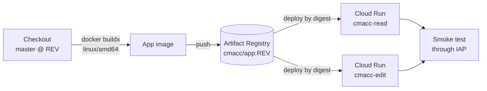
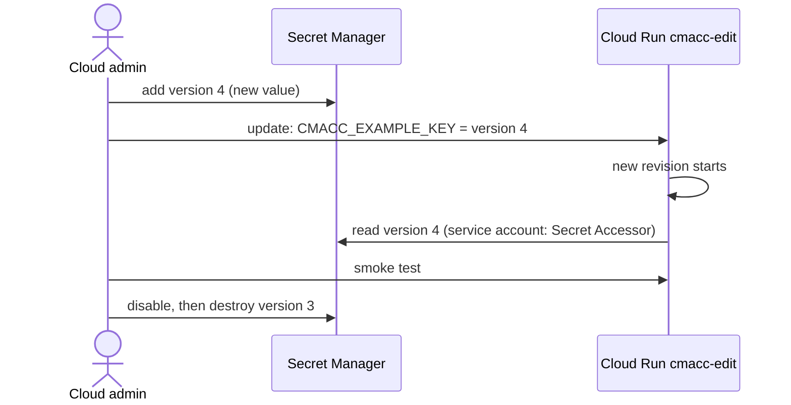

# Use cases: cloud admin

- **Actor**: the cloud admin (architect / tech lead), member of `cmacc-cloud-admins@<domain>`
- Roles and powers: [user-management.md](../user-management.md); hosting: [infra-architecture.md](../infra-architecture.md)
- **Proposed procedure**: the deploy tooling for Google Cloud is not built yet; commands show the intended steps

## 1. Build and deploy what is on `master`

- **Goal**: the app code on the repository's main branch (`master`) running on both Cloud Run services
- **Scope**: the app image only; a deploy never changes the template objects in the bucket (see "Templates are not part of a deploy" below)

### Preconditions

- Local checkout of the repository; OrbStack running; Google Cloud CLI installed and signed in (`gcloud auth login`)
- Docker can push to Artifact Registry (once per machine): `gcloud auth configure-docker <region>-docker.pkg.dev`
- Checks green on `master`: `task app:test`, `task app:lint`, and the parity gate as the release requires

### Steps

1. Update the checkout to `master` and note the commit

   ```bash
   git switch master && git pull
   REV=$(git rev-parse --short HEAD)
   ```

2. Build the app image for Cloud Run's architecture (`linux/amd64`; emulated on an Apple-silicon Mac) and push it

   ```bash
   IMAGE=<region>-docker.pkg.dev/<project>/cmacc/app:$REV
   docker buildx build -f app/Dockerfile --platform linux/amd64 --tag "$IMAGE" --push .
   ```

3. Take the pushed digest: deploys always use the digest, never the tag

   ```bash
   DIGEST=$(gcloud artifacts docker images describe "$IMAGE" --format='value(image_summary.digest)')
   IMAGE_REF=<region>-docker.pkg.dev/<project>/cmacc/app@$DIGEST
   ```

4. Deploy the same image to both services; each keeps its own settings (service account, IAP, saves on or off)

   ```bash
   gcloud run deploy cmacc-read --image "$IMAGE_REF" --region <region>
   gcloud run deploy cmacc-edit --image "$IMAGE_REF" --region <region>
   ```

5. Smoke test through IAP: open `<read-url>` and `<edit-url>`, view a contract ([view-contract.md](view-contract.md))
6. If something is wrong, roll back: send traffic to the previous revision

   ```bash
   gcloud run revisions list --service cmacc-read --region <region>
   gcloud run services update-traffic cmacc-read --to-revisions <previous-revision>=100 --region <region>
   ```



- Each deploy makes a new revision; the old one stays for rollback
- Artifact Registry's cleanup policy keeps the last few images (free tier: 0.5 GB)

### Templates are not part of a deploy

- By design: the bucket is the source of truth for the templates; editors change it through the app ([edit-template.md](edit-template.md))
- A deploy changes the app only; it never writes, deletes or replaces template objects
- Templates are protected by object versioning and by backups taken out of the project ([user-admin.md](user-admin.md))
- `Doc/` is not in this repository: it lives in the separate templates repository, which seeded the bucket once ([todo.md](../todo.md) T2, T11)

## 2. Change a secret

- **Goal**: replace a secret's value (e.g. a rotated API key) and have the app use the new value
- Today the design has no secrets (the database uses IAM authentication); this is the procedure for when one exists
- Example name: `cmacc-example-key`, given to `cmacc-edit` as the environment variable `CMACC_EXAMPLE_KEY`

### Steps

1. Add the new value as a new version; read it from a file or prompt, never type it on the command line

   ```bash
   gcloud secrets versions add cmacc-example-key --data-file=new-key.txt
   rm new-key.txt
   ```

2. Point the service at the new version and roll out a new revision (instances read secrets when they start)

   ```bash
   gcloud secrets versions list cmacc-example-key          # newest version number, e.g. 4
   gcloud run services update cmacc-edit --region <region> \
     --update-secrets=CMACC_EXAMPLE_KEY=cmacc-example-key:4
   ```

   - pin a version number, not `latest`: the deployed revision then says exactly which value it uses, and rollback is a revision switch

3. Check the app works with the new value (smoke test as above)
4. Disable the old version; destroy it once sure it is not needed

   ```bash
   gcloud secrets versions disable 3 --secret cmacc-example-key
   gcloud secrets versions destroy 3 --secret cmacc-example-key   # irreversible
   ```

   - free tier counts active versions (6): destroy old ones rather than keeping them disabled forever



- Access: only the service account that needs the secret holds Secret Accessor, on that one secret
- Every step is recorded in the Admin Activity audit log; the secret value never is
