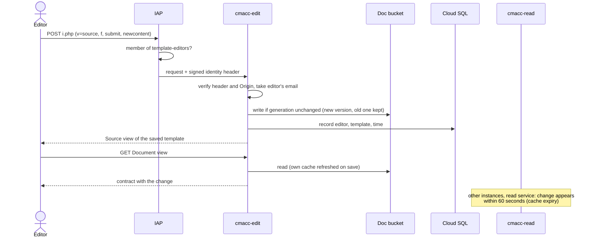

# Use case: a template editor changes a template and sees the result

- **Actor**: a template editor, member of `template-editors@<domain>`
- **Goal**: change a value in a template, save it, and see the contract render with the change
- **Example**: in the SAFE demo `G/YCombinator-SAFE/2026/Demo/Acme-Ang-Cap-NoDiscount.md`, change the purchase amount from `$65,000` to `$80,000`
- **Service**: `cmacc-edit` at `<edit-url>` (saves on); the read service has no Save button

## Preconditions

- The editor is a member of `template-editors`
- The template already exists (saves overwrite existing templates only; new files are not supported)

## Steps

1. Open the contract on the edit service and check the current text:
   `<edit-url>/i.php?v=d&k=r00t&f=G/YCombinator-SAFE/2026/Demo/Acme-Ang-Cap-NoDiscount.md`
   - Google sign-in through IAP as in [view-contract.md](view-contract.md); only `template-editors` get past IAP here
2. In the tab bar choose **OpenParameters** (`v=o`)
   - a text box shows the template as it is, with a header line and suggested lines for any unfilled fields above it
3. Edit the text
   - change `PurchaseAmount.$=$65,000` to `PurchaseAmount.$=$80,000`
   - delete the header and suggestion lines if they should not be saved: Save writes the box exactly as it is (legacy behavior)
4. Press **Save**
   - the page switches to the **Source** view of the saved template; a missing file shows `ERROR: File … does not exists.`
   - if someone else saved this template since the editor opened it, the save is refused ("changed since you opened it, reload"): reload, redo the change, save again
5. Check the source table: `PurchaseAmount.$` now reads `$80,000`
6. Open the **Document** tab: the SAFE now states the purchase amount as $80,000
7. Optional: open the same link on `<read-url>` to see what users see

## What happens behind the scenes

- The text is normalized before writing: Windows line endings become `\n`, leading and trailing whitespace trimmed
- The previous text is kept as an older object version: a user admin can restore it ([user-admin.md](user-admin.md))

## Things to know

- **Visible at once** on the edit service; everywhere within a minute (read caches expire after 60 seconds, [app-architecture.md](../app-architecture.md))
- **The bucket is the record**: the change is kept there, with earlier versions and off-project backups; app deploys never change it ([cloud-admin.md](cloud-admin.md))
- **Git sees the save the next morning**: the daily backup job commits it to the templates repository's `cloud-backup` branch ([todo.md](../todo.md) T7)
- **No silent overwrites**: if two editors change the same template, the second save is refused and that editor reloads; nothing is lost
- **Existing templates only**: a new template is uploaded by a user admin ([user-admin.md](user-admin.md))
- **Every template that includes this one changes too**: check the documents that build on it, not only the one edited
