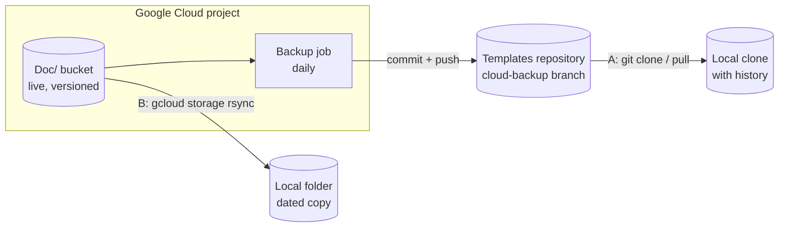
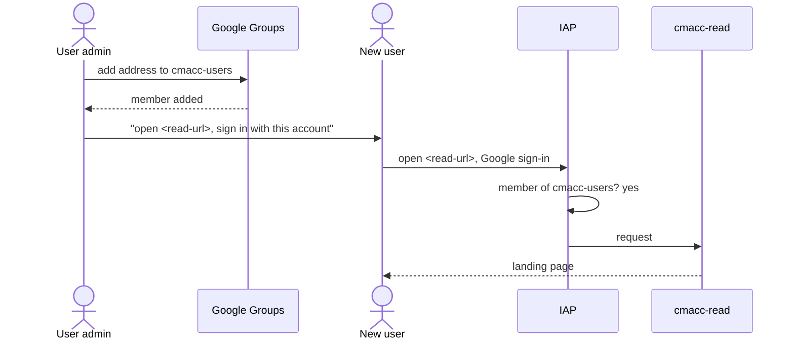

# Use cases: user admin

- **Actor**: a user admin, member of `cmacc-user-admins@<domain>`
- Roles and powers: [user-management.md](../user-management.md)

## 1. Back up the templates to a local file system

- **Goal**: a complete copy of the `Doc/` tree on the admin's own machine (or a drive it controls), outside the Google Cloud project
- **Who**: a user admin, or the cloud admin (a superset of the user admin)
- The templates exist in three places:

| Copy | Kept by | Up to date | Holds history |
|---|---|---|---|
| `Doc/` bucket | Cloud Storage, object versioning | live | every saved version |
| `cloud-backup` branch of the templates repository | automated job, daily ([todo.md](../todo.md) T7) | as of the last run | one commit per run with changes |
| local copy | the admin, this use case | as of the copy | git history if cloned, none if copied from the bucket |

- Normal route: clone the backup branch (way A); copy straight from the bucket (way B) when the latest saves are needed or the automated backup has stopped



### Preconditions

- Way A: read access to the templates repository on the git host (granted by the cloud admin); `git` installed
- Way B: Google Cloud CLI installed (e.g. `brew install --cask google-cloud-sdk`); the admin's Google account in `cmacc-user-admins` (Storage Object Admin on the bucket)
- Enough local disk: the tree is about 40 MB, under 7,000 files

### Way A: from the git backup (routine)

1. First time: clone only the backup branch

   ```bash
   git clone --branch cloud-backup --single-branch <templates-repo-url> ~/cmacc-backup
   ```

   Later times: update the clone

   ```bash
   git -C ~/cmacc-backup pull --ff-only
   ```

2. Check the automated backup is running: the newest commit should be from the last day or two

   ```bash
   git -C ~/cmacc-backup log -1 --format='%ci %s'
   ```

   - older than that: the job has stopped; tell the cloud admin (they also get an alert) and use way B meanwhile
   - no new commit can also mean nobody saved anything: the job does not make empty commits

3. Keep the copy safe: the clone is a full backup with history; copy it to the backup system as company policy says
4. Do not commit or push to the `cloud-backup` branch: only the backup job writes there

### Way B: straight from the bucket

1. Sign in and select the project (once per machine)

   ```bash
   gcloud auth login
   gcloud config set project <project>
   ```

2. Copy the tree into a dated folder

   ```bash
   BACKUP=~/cmacc-backups/$(date +%Y-%m-%d)
   mkdir -p "$BACKUP"
   gcloud storage rsync --recursive gs://<bucket>/Doc "$BACKUP/Doc"
   ```

3. Check the copy is complete: the two counts must match

   ```bash
   gcloud storage ls --recursive "gs://<bucket>/Doc/**" | wc -l
   find "$BACKUP/Doc" -type f | wc -l
   ```

4. Keep the folder safe as in way A

### Restore (for reference)

- Three sources, newest first; every restore writes a new object version, so it can itself be undone, and the next backup run commits it to git
- From an earlier version in the bucket (no backup needed)

  ```bash
  gcloud storage ls --all-versions gs://<bucket>/Doc/G/x.md        # lists name#generation
  gcloud storage cp gs://<bucket>/Doc/G/x.md#<generation> gs://<bucket>/Doc/G/x.md
  ```

- From a git backup commit

  ```bash
  git -C ~/cmacc-backup log --format='%h %ci' -- Doc/G/x.md      # commits that changed it
  git -C ~/cmacc-backup show <commit>:Doc/G/x.md > /tmp/x.md
  gcloud storage cp /tmp/x.md gs://<bucket>/Doc/G/x.md
  ```

- From a local folder: `gcloud storage cp "$BACKUP/Doc/G/x.md" gs://<bucket>/Doc/G/x.md`

## 2. Add a new user

- **Goal**: let a new person read contracts in the app (or edit templates)
- **Tools**: Google Groups in the browser (`groups.google.com`); the Google Admin console (`admin.google.com`) works too
- No Google Cloud console and no command line needed: access to the app is group membership

### Preconditions

- The new person has a Google account (company domain or any other, e.g. gmail.com) and has given the admin its address
- The admin is an owner of `cmacc-users` and `template-editors`
- Groups allow members outside the domain, if the person's account is outside it (set once by a cloud admin)

### Steps

1. Open `groups.google.com`, signed in with the admin's account
2. Open the group:
   - `cmacc-users` to read contracts
   - `template-editors` to edit templates (editors can also read, no need to add them to both)
3. **Members** → **Add members**
4. Enter the person's Google account address
5. Choose to add directly, with or without a welcome email; the email can say where the app is: `<read-url>` (and `<edit-url>` for editors)
6. **Add to group**
7. Tell the person to open `<read-url>` and sign in with that exact account
   - the first visit can take a few minutes to work while access spreads; a "You don't have access" page in that window clears on retry



### Removing a user

- Same place: **Members** → select the person → **Remove from group**
- Access ends at the person's next request once the change has spread (a few minutes); there is no app session to end

## 3. Add a new template

- **Goal**: a template that does not exist yet becomes available, so editors can work on it
- Editors cannot create templates through the app (existing templates only); a user admin uploads the first version
- **Tools**: Google Cloud CLI, as in way B of the backup

### Steps

1. Write the template locally, e.g. `G/Acme/NDA/v1.md`, starting from a copy of a similar template
2. Check the path is not taken (no output = free):

   ```bash
   gcloud storage ls gs://<bucket>/Doc/G/Acme/NDA/v1.md
   ```

3. Upload it, refusing to overwrite if it appeared in the meantime:

   ```bash
   gcloud storage cp --no-clobber G/Acme/NDA/v1.md gs://<bucket>/Doc/G/Acme/NDA/v1.md
   ```

4. Open it on the read service within a minute (cache expiry): `<read-url>/i.php?v=d&k=r00t&f=G/Acme/NDA/v1.md`
5. Tell the editors; from now on they change it through the app; the next backup run commits it to git
