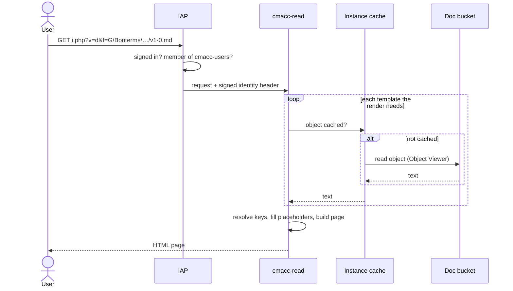

# Use case: a user views a rendered contract

- **Actor**: a user, member of `cmacc-users@<domain>`
- **Goal**: read the finished text of a contract, e.g. the Bonterms Mutual NDA
- **Service**: `cmacc-read` at `<read-url>` (read only)

## Preconditions

- The user has a Google account and is a member of `cmacc-users` (added by a user admin: [user-admin.md](user-admin.md))
- `cmacc-read` is deployed and the `Doc/` bucket holds the templates

## Steps

1. The user opens `<read-url>` in a browser
2. IAP redirects to Google sign-in; the user signs in with the Google account that is in the group
   - already signed in to Google: no prompt, straight through
3. The landing page appears (the configured landing template)
4. The user browses to the contract
   - **Docs** link → folder listing (`i.php?v=l&f=`) → `G/` → `Bonterms/` → `Mutual-NDA/` → `Form/` → `v1-0.md`
   - or follows a link someone shared: `<read-url>/i.php?v=d&k=r00t&f=G/Bonterms/Mutual-NDA/Form/v1-0.md`
5. The Document view shows the assembled contract: every include resolved, values filled in, unfilled fields highlighted
6. Optional, from the tab bar (no GitHub links on the cloud deployment: git holds only backups):
   - **Print**: clean text for printing or copying
   - **Source**: the template's own key/value lines, with links to the templates it includes
   - **Visual**: the same text with a different stylesheet
   - fields still to fill in: no tab; change `v=d` to `v=m` in the address
   - no Save button anywhere: the read service cannot write

- To leave: **Sign out** in the header ends the Google sign-in for the app

## What happens behind the scenes

- One render reads the document and every template it includes (often dozens); the per-instance cache keeps repeat views cheap
- First request after a quiet period starts a new instance (scale to zero): a few seconds slower, then normal

## Other outcomes

| Situation | What the user sees |
|---|---|
| Not signed in to the right Google account, or not in a group | IAP "You don't have access" page; the app is never reached |
| Path does not exist | `No such document: <path>` |
| An included template is missing | The rest of the contract renders; the missing include is reported in the page source, not the text |
| Cloud Storage fails to return a template after retries | That template is reported like a missing include; the rest renders |
| A runaway template hits a render budget | "Nothing to Show" (never half a document; [decisions](../decisions.md) D3) |
