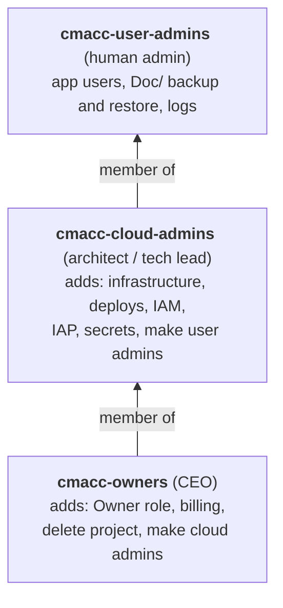
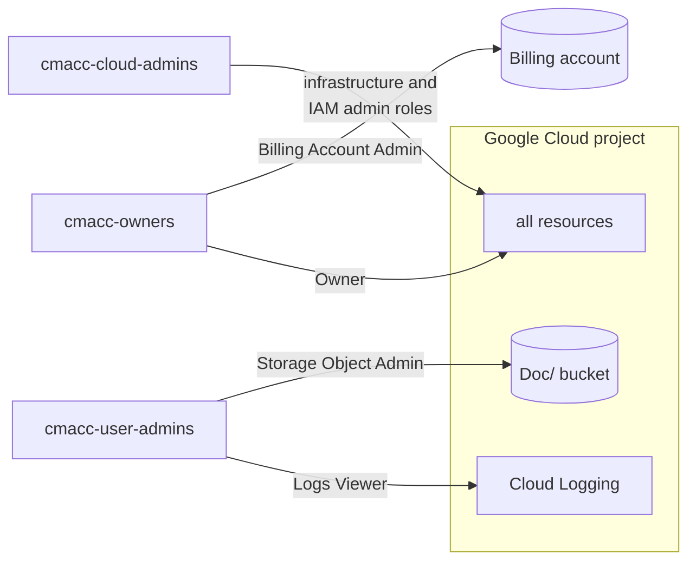
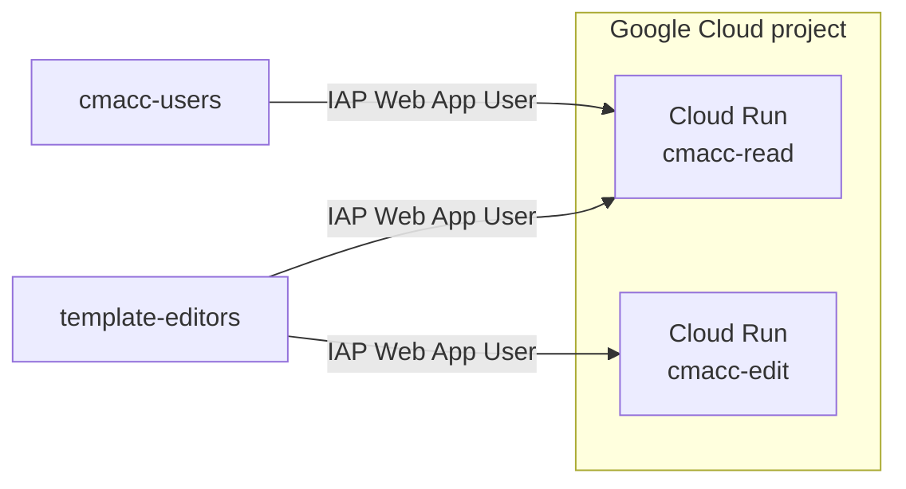
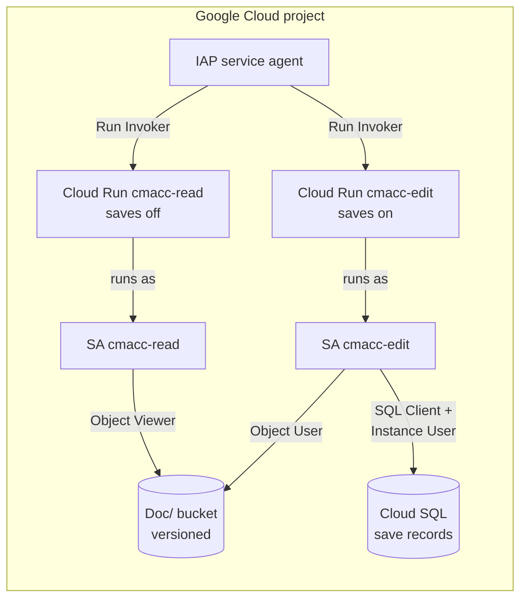
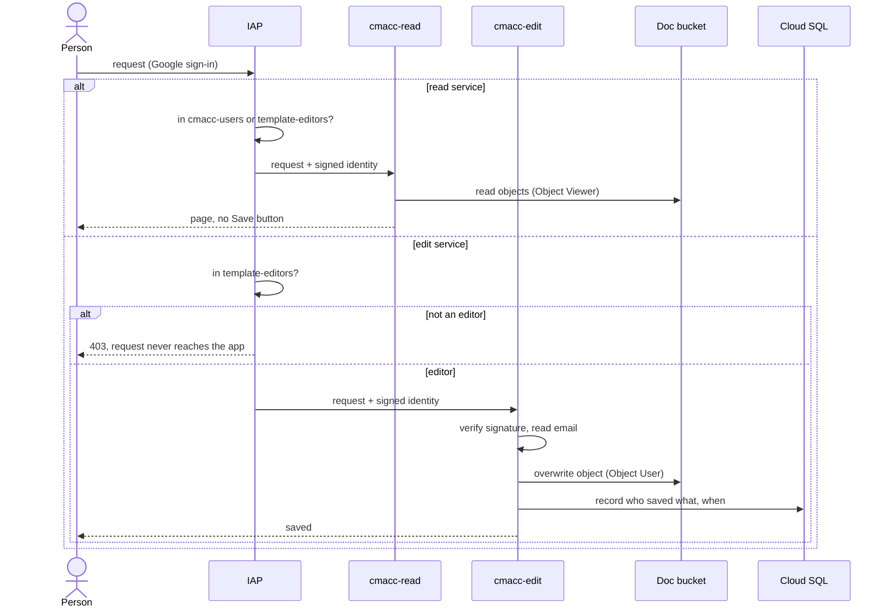
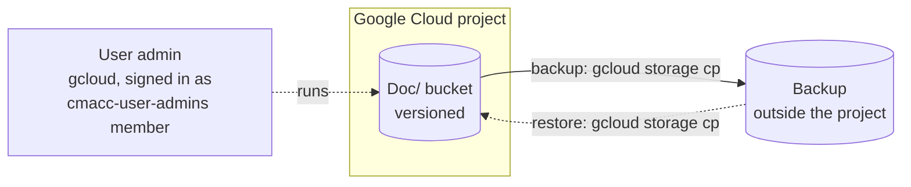

# User management

- **Proposed**: who can do what on the Google Cloud deployment, and which groups, roles and resources that needs
- Hosting context: [infra-architecture.md](infra-architecture.md); the app's data store: [app-architecture.md](app-architecture.md)
- Group, bucket and service names below are placeholders (`<domain>`, `<bucket>`)

## Principles

- People get access through Google groups, never one by one: changing a person's access = changing group membership
- Every person signs in with a Google account through IAP; no app-local passwords or user list
- Authorization is done by Google Cloud (IAP and IAM), not by app code
  - read and edit are two Cloud Run services from the same image; IAP lets only editors reach the edit service
  - so the app never has to look up group membership (that lookup needs a paid Workspace or Cloud Identity Premium licence)
- Administration is layered: project owner ⊇ cloud admin ⊇ user admin; each layer is a group nested in the one below, so it inherits that layer's roles
- App users get no direct access to the app's resources (bucket, database, secrets); only the admin layers do
- Each service runs as its own service account with only what it needs: the read service cannot write documents
- Roles granted on the one resource that needs them (bucket, service), not project-wide, wherever Google Cloud allows

## Identity prerequisites

- IAP's default (Google-managed) OAuth client only admits users of the project's own organization
  - a project with no organization and no custom OAuth client fails every request (HTTP 502)
- Lean setup:
  - organization from **Cloud Identity Free** (no charge; needs a domain the company controls); the groups below live there
  - **custom OAuth client** for IAP, so people with any Google account (e.g. gmail.com) can be let in, not only accounts in the domain
  - OAuth consent screen set to external; created once in the Google Cloud console
- If every user has an account in the organization's domain, the Google-managed client is enough and the custom client can be skipped

## Roles and groups

| Role | Group | Who | Purpose |
|---|---|---|---|
| Project owner | `cmacc-owners@<domain>` | the CEO | everything, including billing and deleting the project |
| Cloud admin | `cmacc-cloud-admins@<domain>` | the architect / tech lead | build, deploy, run and secure the project, IAM included; everything except billing |
| User admin | `cmacc-user-admins@<domain>` | the human admin(s) | manage app users; back up and restore the `Doc/` objects |
| Template editor | `template-editors@<domain>` | people who maintain templates | use the app and save template changes |
| User | `cmacc-users@<domain>` | everyone else allowed in | use the app, read only |



- Nesting makes the superset: the owners group is a member of the cloud admins group, which is a member of the user admins group
- Group ownership (a Cloud Identity group setting, not an IAM role) decides who manages membership:
  - owners own `cmacc-owners`
  - cloud admins own `cmacc-cloud-admins` and `cmacc-user-admins`
  - user admins own `template-editors` and `cmacc-users`
- Groups must allow members outside the domain if users have other Google accounts
- App access is not inherited from admin roles: anyone who wants to use the app joins `cmacc-users` or `template-editors`

## Powers

### Project owner (`cmacc-owners`): the CEO

- Everything the cloud admin can do (by nesting), plus:
  - Owner role (`roles/owner`) on the project, including deleting the project
  - Billing Account Administrator on the billing account: link or unlink the project, payment, budgets and budget alerts
  - makes and removes cloud admins (owns `cmacc-cloud-admins` through the cloud admins' group, and holds Owner)
- Normally hands-off: the cloud admin runs the project; the owner approves spending and is the last resort if the cloud admin is unavailable

### Cloud admin (`cmacc-cloud-admins`): the architect / tech lead

- Everything the user admin can do (by nesting), plus:
  - create, change and delete the infrastructure: Cloud Run services, bucket, Cloud SQL instance, Artifact Registry, service accounts, secrets, APIs
  - deploy new app versions
  - change IAM on the project, unrestricted: grant and remove any role, IAP access, service account permissions
  - configure IAP and its OAuth client and consent screen
  - monitoring and alert policies
  - make and remove user admins (owns `cmacc-user-admins`)
- Cannot, without the owner:
  - billing: link or unlink the billing account, see or change payment, set budgets (these are roles on the billing account, outside the project)
  - delete the project
- Note: unrestricted IAM means the cloud admin could grant itself Owner on the project; this is accepted, and visible in the audit log. Billing stays out of reach either way, because billing roles live on the billing account, not the project

### User admin (`cmacc-user-admins`)

- Users
  - add and remove members of `cmacc-users` and `template-editors` (group owner)
  - the groups are the access list: who is in a group is who can reach that service
- `Doc/` objects
  - list, read, copy out: backups with `gcloud storage cp` to a system outside the project
  - overwrite, delete, restore earlier versions: restore from a backup or from object versioning
  - limited to the one bucket
- Templates repository (on the git host, outside Google Cloud): read access, to clone the `cloud-backup` branch as a local backup; granted by the cloud admin; only the backup job writes to that branch ([todo.md](todo.md) T7)
- Audit: read logs, including which user saved which template and every admin action
- Cannot: deploy or change the app, change IAM or IAP, read secrets, reach the database, make admins

### Template editor (`template-editors`)

- Everything a normal user can do, on the read service
- On the edit service: save template changes (Open-edit view, Source and JSON saves)
  - the edit service writes the object as its own service account, and records the editor's verified Google identity with the save
  - same rule as today: existing templates only, no new files
- Cannot: touch the bucket, database or any Google Cloud resource directly; manage users

### User (`cmacc-users`)

- Sign in with a Google account through IAP, on the read service
- Read: landing page, folder listing, every document view, source and JSON views, supporting files
- Cannot: save (the read service has no Save button, rejects save requests, and its service account cannot write); reach the edit service; any direct Google Cloud access

### Summary

| Power | Owner | Cloud admin | User admin | Template editor | User |
|---|---|---|---|---|---|
| Use the read service | if in an app group | if in an app group | if in an app group | yes | yes |
| Use the edit service, save templates | if in `template-editors` | if in `template-editors` | if in `template-editors` | yes | no |
| Manage app users | yes | yes | yes | no | no |
| Back up, restore `Doc/` objects directly | yes | yes | yes | no | no |
| Read logs | yes | yes | yes | no | no |
| Make user admins | yes | yes | no | no | no |
| Build, deploy, change infrastructure | yes | yes | no | no | no |
| Change IAM and IAP | yes | yes | no | no | no |
| Secrets, database admin | yes | yes | no | no | no |
| Make cloud admins | yes | no | no | no | no |
| Billing, budgets | yes | no | no | no | no |
| Delete the project | yes | no | no | no | no |

### Safeguards

- 2-Step Verification required on every admin-layer account
- Cloud Identity super admin held by two accounts (CEO and tech lead), so the organization is never locked
- No service account keys; automation, if any, uses Workload Identity Federation
- Admin layers do routine work with the least role that does it: backups as user admin, not as Owner
- Every admin action is in the Admin Activity audit log (always on, free); user admins can read it

## Resources and role bindings

Administration (each layer also inherits the roles of the layers below it):



App access:



Services and what they can reach:



| Principal | Role | Granted on |
|---|---|---|
| `group:cmacc-owners@<domain>` | Owner (`roles/owner`) | project |
| `group:cmacc-owners@<domain>` | Billing Account Administrator (`roles/billing.admin`) | billing account |
| `group:cmacc-cloud-admins@<domain>` | Project IAM Admin (`roles/resourcemanager.projectIamAdmin`) | project |
| `group:cmacc-cloud-admins@<domain>` | Cloud Run Admin (`roles/run.admin`), Service Account Admin (`roles/iam.serviceAccountAdmin`), Service Account User (`roles/iam.serviceAccountUser`) | project |
| `group:cmacc-cloud-admins@<domain>` | Storage Admin (`roles/storage.admin`), Cloud SQL Admin (`roles/cloudsql.admin`), Artifact Registry Administrator (`roles/artifactregistry.admin`), Secret Manager Admin (`roles/secretmanager.admin`) | project |
| `group:cmacc-cloud-admins@<domain>` | IAP Policy Admin (`roles/iap.admin`), IAP Settings Admin (`roles/iap.settingsAdmin`), OAuth Config Editor (`roles/oauthconfig.editor`, Beta) | project |
| `group:cmacc-cloud-admins@<domain>` | Service Usage Admin (`roles/serviceusage.serviceUsageAdmin`), Monitoring Editor (`roles/monitoring.editor`) | project |
| `group:cmacc-user-admins@<domain>` | Storage Object Admin (`roles/storage.objectAdmin`) | the `Doc/` bucket |
| `group:cmacc-user-admins@<domain>` | Logs Viewer (`roles/logging.viewer`) | project |
| `group:cmacc-users@<domain>` | IAP-secured Web App User (`roles/iap.httpsResourceAccessor`) | `cmacc-read` service |
| `group:template-editors@<domain>` | IAP-secured Web App User (`roles/iap.httpsResourceAccessor`) | `cmacc-read` and `cmacc-edit` services |
| IAP service agent (`service-<number>@gcp-sa-iap.iam.gserviceaccount.com`) | Cloud Run Invoker (`roles/run.invoker`) | both services |
| `serviceAccount:cmacc-read` | Storage Object Viewer (`roles/storage.objectViewer`) | the `Doc/` bucket |
| `serviceAccount:cmacc-edit` | Storage Object User (`roles/storage.objectUser`) | the `Doc/` bucket |
| `serviceAccount:cmacc-edit` | Cloud SQL Client (`roles/cloudsql.client`), Cloud SQL Instance User (`roles/cloudsql.instanceUser`) | project |

- Cloud admin: predefined roles, not the basic Editor role; add a role when a new service is adopted (e.g. Cloud Build)
- No service uses the default Compute Engine service account (it has broad Editor rights by default)
- Database login by IAM database authentication: no database password, so no secret to store
- Using the app needs IAP Web App User, which no admin role includes
- Bucket: uniform bucket-level access (no per-object ACLs), public access prevention on, object versioning on

## How a request is authorized

- IAP decides who reaches each service; the service's own permissions decide what it can do
- The app still verifies the signed IAP header (`X-Goog-IAP-JWT-Assertion`) before trusting the email it records with a save



## Backup and restore

- Done by a user admin (or any layer above, through nesting)



```bash
# backup: copy the document tree out of the project
gcloud storage cp --recursive gs://<bucket>/Doc ./backup/
# restore one template from the backup
gcloud storage cp ./backup/Doc/G/x.md gs://<bucket>/Doc/G/x.md
# list earlier versions of one template (object versioning)
gcloud storage ls --all-versions gs://<bucket>/Doc/G/x.md
```

## Open

- Domain for the Cloud Identity Free organization, and whether users are inside it (decides whether a custom OAuth client is needed)
- A second billing administrator, so billing is not locked if the CEO's account is lost
- Whether deploys stay manual (cloud admin runs `gcloud` or Terraform) or move to automation with its own deployer service account
- Whether user admins also read save records in the database (today: through logs only)
- Retention: how many old object versions to keep, and for how long
